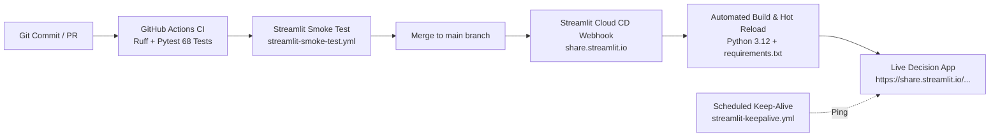

# Streamlit Cloud Deployment & Automation Guide

This document details the automated deployment architecture and continuous delivery flow for the **Bank Customer Churn Decision Support Platform**.

---

## ⚡ 1-Click Instant Deployment

Deploy this exact repository directly to Streamlit Community Cloud with pre-filled settings:

[](https://share.streamlit.io/deploy?repository=ronaldgosso/bank-churn&branch=main&mainModule=app/Home.py)

**Direct Deployment Link:**  
👉 [https://share.streamlit.io/deploy?repository=ronaldgosso/bank-churn&branch=main&mainModule=app/Home.py](https://share.streamlit.io/deploy?repository=ronaldgosso/bank-churn&branch=main&mainModule=app/Home.py)

---

## 🔄 Automated CI/CD Deployment Flow



### Automation Workflows Included:
1. **Continuous Integration (`.github/workflows/ci.yml`):**
   - Lints code with Ruff.
   - Runs full unit and integration test suite (68 tests) on Python 3.12.
2. **Streamlit Deployment Health Check (`.github/workflows/streamlit-smoke-test.yml`):**
   - Automatically runs on pull requests and pushes to `main`.
   - Boots a headless Streamlit server in containerized CI.
   - Probes the `/_stcore/health` endpoint to guarantee cold start under 30 seconds before deployment.
3. **Streamlit Keep-Alive Ping (`.github/workflows/streamlit-keepalive.yml`):**
   - Runs on schedule twice daily (08:00 and 20:00 UTC).
   - Pings your live Streamlit URL to prevent free-tier inactive sleep mode.

---

## 🛠️ Step-by-Step Setup on Streamlit Community Cloud

### Step 1: Sign in to Streamlit Cloud
1. Navigate to [share.streamlit.io](https://share.streamlit.io/).
2. Sign in with your **GitHub** account (`ronaldgosso`).

### Step 2: Create New Application
Click the **"New app"** button and fill in the deployment configuration:
- **Repository:** `ronaldgosso/bank-churn`
- **Branch:** `main`
- **Main file path:** `app/Home.py`
- **App URL (optional):** Choose a custom subdomain (e.g. `bank-churn-decisions.streamlit.app`)

### Step 3: Advanced Settings (Runtime Configuration)
Under **Advanced settings**:
- **Python version:** Select `3.12` (or `3.11`).
- **Secrets (optional):** If integrating external services, paste secrets here. The churn application runs fully self-contained using committed model weights and data summaries.

### Step 4: Click "Deploy!"
Streamlit Cloud will:
1. Provision a secure container.
2. Install pinned dependencies from `requirements.txt`.
3. Apply theme settings from `.streamlit/config.toml`.
4. Launch `app/Home.py` and mount all 6 pages under `app/pages/`.

> **Note on REST APIs vs. Streamlit Cloud:**  
> Streamlit Community Cloud hosts the interactive WebSocket dashboard (`https://<subdomain>.streamlit.app`). Appending subpaths like `/api/v2/...` to the Streamlit app URL returns an **HTTP 404** from Streamlit Cloud's edge router. To access or expose the FastAPI REST API (`/predict`, `/predict/recourse`, `/health`), deploy the container using the Dockerfile on Render, Railway, Fly.io, or AWS ECS as documented below.

---

## ⚙️ Configuration Files Overview

| File | Purpose |
| :--- | :--- |
| **`requirements.txt`** | Minimal, pinned runtime dependencies with PEP 508 version markers for Python 3.11 and 3.12+. |
| **`.streamlit/config.toml`** | Corporate brand theme (`primaryColor = "#2563eb"`, background `#f8fafc`, headless server mode, CORS flags). |
| **`models/churn_model.joblib`** | Serialized calibrated XGBoost production pipeline artifact (~1.6 MB). |
| **`models/metadata.json`** | Model version, hash, training date, hyperparameters, and optimal decision threshold. |
| **`app/utils.py`** | Memory caching (`@st.cache_resource` for model/explainer, `@st.cache_data` for reports) ensuring instantaneous page reloads. |

---

## 🔔 Enabling the Automated Keep-Alive Ping

Streamlit Community Cloud puts apps without web traffic to sleep after several days of inactivity. To automate keep-alive pings:

1. Copy your deployed Streamlit URL (e.g. `https://bank-churn.streamlit.app`).
2. Go to your GitHub repository: **Settings &rarr; Secrets and variables &rarr; Actions**.
3. Under **Repository secrets** (or **Variables**), click **New repository variable / secret**:
   - **Name:** `STREAMLIT_APP_URL`
   - **Value:** `https://bank-churn.streamlit.app`
4. The workflow `.github/workflows/streamlit-keepalive.yml` will now automatically keep your application warm on schedule.

---

## 🐳 Alternative Deployment Options

### 1. Docker (Containerized Cloud Run / Render / Fly.io)
A multi-stage `Dockerfile` is included in the root directory:

```bash
# Build production Docker container
docker build -t bank-churn:latest .

# Run FastAPI service (Port 8000)
docker run -p 8000:8000 bank-churn:latest

# Or launch Streamlit directly from the container
docker run -p 8501:8501 bank-churn:latest streamlit run app/Home.py --server.port 8501 --server.address 0.0.0.0
```

### 2. Hugging Face Spaces
1. Create a new Space on [huggingface.co/spaces](https://huggingface.co/spaces) selecting the **Streamlit** SDK.
2. Link or push this repository.
3. Set the main application file to `app/Home.py`.
