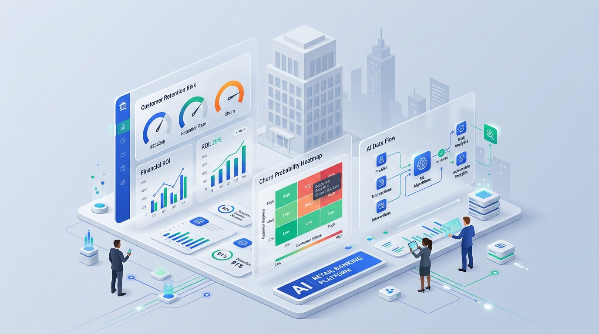
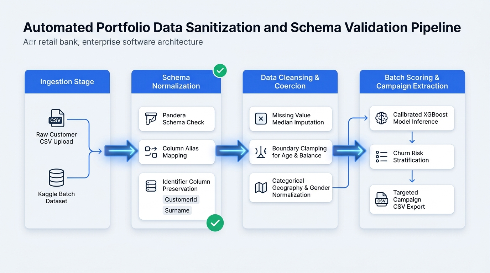
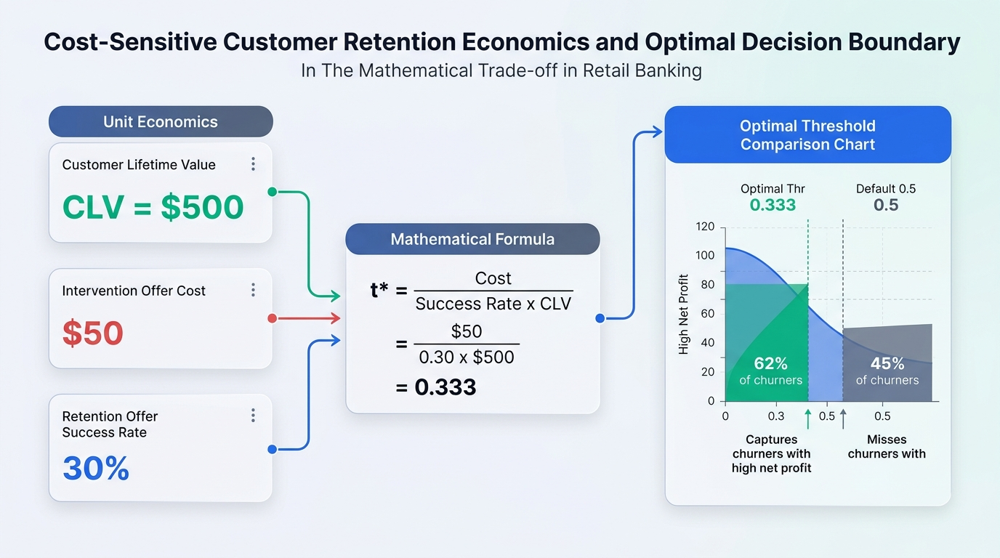

# Bank Customer Churn Prediction & Decision Support System

[](https://bankcustomerchurning.streamlit.app/)
[](https://www.python.org/downloads/)
[](https://github.com/astral-sh/ruff)
[](https://opensource.org/licenses/MIT)
[](https://colab.research.google.com/github/ronaldgosso/bank-churn/blob/main/notebooks/01_eda.ipynb)
[](https://colab.research.google.com/github/ronaldgosso/bank-churn/blob/main/notebooks/02_modeling.ipynb)
[](https://colab.research.google.com/github/ronaldgosso/bank-churn/blob/main/notebooks/03_evaluation_explainability.ipynb)

> **An intelligent, prescriptive decision-support platform for retail banking. It predicts customer departure risk with calibrated machine learning, explains root causes with SHAP, optimizes intervention thresholds for maximum business profit, and equips relationship managers with actionable retention playbooks.**

🌐 **Live Web Application:** [bankcustomerchurning.streamlit.app](https://bankcustomerchurning.streamlit.app/)  
📖 **Comprehensive User & Metric Guide:** [Streamlit_app.md](Streamlit_app.md)

---

## 🎯 The Business Dilemma & Why This Matters

Retail banking is an asymmetric business: **acquiring a new customer costs 5 to 7 times more than retaining an existing one.** When an account holder leaves, the bank loses deposit balances, net interest margin (NIM), cross-sell potential, and fee revenues.

Yet, banks face two chronic operational challenges:
1. **Limited Retention Budgets:** Banks cannot afford to give monetary concessions ($50 offers, fee waivers, bonus interest) to all 100,000+ customers.
2. **The Flaw of Standard 0.50 Thresholds:** Off-the-shelf machine learning models default to a `0.50` probability cutoff. Because churn is an imbalanced event (~20% base rate), this arbitrary threshold **misses over 45% of genuine churners**, allowing millions in deposits to silently drain away.

```
  Traditional Approach (Naive 0.50 Cutoff):
  [ 0.00 ........................... 0.49 ] [ 0.50 .................... 1.00 ]
  ❌ Misses 45%+ of genuine churners        ⚠️ Intervenes only on obvious flight risks
     Lost revenue: $100k+ in runoff           Wasted budget on uncalibrated guesses

  This Platform (Cost-Sensitive Optimal Threshold t* = 0.333):
  [ 0.00 ... 0.16 ] [ 0.17 ....... 0.33 ] [ 0.333 .................... 1.00 ]
  🟢 SAFE ZONE      🟡 WATCHLIST          🔴 ACTIVE RETENTION ZONE
     Preserve          Automated             Direct Banker Outreach Justified
     Budget            Digital Nudges        Expected Net ROI is Positive!
```

---

## 💡 What This System Does (In a Nutshell)

This platform moves beyond passive risk scoring into **prescriptive decision intelligence**:

1. **Calibrated Predictive Engine:** An Optuna-tuned tree ensemble (XGBoost) wrapped in 5-fold Isotonic Regression. The predicted numbers represent **real-world probabilities** (Brier score `0.0994`), meaning a 35% score corresponds to an actual 35% empirical departure rate.
2. **Cost-Sensitive Decision Theory:** The decision boundary ($t^* = 0.333$) is mathematically calculated from Customer Lifetime Value (CLV $500), offer cost ($50), and save rate (30%), **maximizing net campaign profit**.
3. **Root-Cause Explainability:** Every customer prediction is decomposed with SHAP (SHapley Additive exPlanations) so branch staff immediately see *why* an account is at risk.
4. **Prescriptive Counterfactual Recourse:** Rather than just diagnosing *who* might leave, the engine simulates *what concrete actions* (mobile banking enrollment, product consolidation, card incentives) will reduce risk and forecasts expected net ROI.
5. **Portfolio Capital-at-Risk Management:** Ingests batch customer files, runs automated data hygiene audits, segments accounts into a 2x2 Value-Risk Matrix, and exports targeted retention call-lists.

---

## 🚀 Live Interactive Platform Tour

The system is delivered as an interactive decision-support application built for branch managers, campaign planners, and risk officers.

[](https://bankcustomerchurning.streamlit.app/)



### 1. Customer Risk Scorer & Banker Playbook
*Score individual accounts on demand with real-time explainability and actionable prescriptive recourse.*
- **Radial Risk Gauge:** Instantly classifies risk into Safe (Green), Watchlist (Amber), and High Risk (Red) relative to the $0.333$ profit threshold.
- **SHAP Decision Waterfall:** Visualizes how specific features (e.g., holding 3 products, inactive member status) elevate or reduce churn log-odds.
- **Prescriptive Intervention Table:** Evaluates concrete retention actions (Digital Activation, Product Consolidation, Rewards Card) and ranks them by **Expected Net ROI ($)**.
- **Relationship Manager Playbook:** Generates personalized call scripts with greetings, customer observations, tailored pitches, and risk reduction forecasts.
- **Interactive What-If Sandbox:** Lets bankers test operational adjustments dynamically to observe real-time probability impact.

---

### 2. Portfolio Explorer & 2x2 Value-Risk Matrix
*Analyze entire customer portfolios, audit data hygiene, and export high-priority campaign lists.*



- **Automated Data Sanitization:** Powered by Pandera schemas—automatically maps column aliases (e.g., `country` $\to$ `Geography`), clamps extreme outliers, imputes missing values, and preserves customer IDs.
- **Portfolio Exposure KPIs:** Tracks Total Assets Held, High-Risk Balance Share, Campaign Budget, and **Expected Balance Runoff** (probabilistic annual deposit loss).
- **2x2 Strategic Action Matrix:** Segments the entire portfolio into four high-impact quadrants:
  - 🔴 **VIP Save Priority (High Risk / High Balance):** Top priority for senior relationship manager outreach and bespoke concessions.
  - 🟡 **Automated Digital Save (High Risk / Modest Balance):** Cost-effective automated app notifications and email incentives.
  - 🔵 **Relationship Deepening (Low Risk / High Balance):** Loyal affluent customers targeted for wealth management cross-selling.
  - 🟢 **Standard Service (Low Risk / Modest Balance):** Stable accounts requiring zero retention spend.
- **One-Click Campaign CSV Export:** Filter by strategic priority, risk tier, or geography, and download ready-to-use call lists.

---

### 3. Retention Campaign Business Simulator
*Model the financial ROI of retention campaigns and simulate the effect of budget constraints.*



- **Interactive Unit Economics Sliders:** Adjust Customer Lifetime Value ($100–$2,000), Offer Cost ($10–$200), Offer Save Rate (5%–80%), and Budget Cap (Top K% Risk).
- **Profit vs. Threshold Sensitivity Curve:** Visually demonstrates the convex profit peak at $t^* = 0.333$ and shows the revenue lost by using default $0.50$ cutoffs.
- **Cumulative Gain & Lift Curves:** Shows how targeting the top 10% or 20% of accounts captures the majority of portfolio churners.
- **10-Decile Performance Breakdown:** Full transparency into decile churn rates, capture percentages, and lift multipliers.

---

### 4. Model Transparency & Fairness Audit
*Complete visibility into machine learning benchmarks, diagnostic curves, and demographic equity.*
- **Cross-Validation Benchmark:** Compares Logistic Regression, Random Forest, LightGBM, and Tuned XGBoost across 6 metrics.
- **Holdout ROC & PR Curves:** Demonstrates high discrimination (ROC-AUC `0.8682`, PR-AUC `0.7174`).
- **Probability Calibration (Reliability Diagram):** Proves predicted probabilities match empirical churn rates (Brier score `0.0994`).
- **Global Feature Ranking:** Identifies the macro drivers of customer departure.
- **Demographic Fairness Audit:** Evaluates selection rate ratios, recall gaps, and precision gaps across Gender and Geography.

---

### 5. Developer Hub & Headless Microservice
*Dual-layer architecture serving both interactive users and enterprise systems.*
- **In-Browser REST Console:** Test live inference payloads against `POST /predict`, `POST /predict/recourse`, and `POST /predict/batch`.
- **Multi-Language Client Snippets:** Copy-paste ready code in cURL, Python (`requests`), and TypeScript (`fetch`).
- **Production Container Specs:** Dockerized microservice ready to deploy on any cloud container runtime.

---

## 📊 Key Results on Holdout Test Cohort

*Evaluated strictly once on the 2,000-customer holdout test partition (`reports/metrics.json`):*

| Business & ML Metric | Industry Benchmark | Verified Model Result | Operational Impact |
| :--- | :--- | :--- | :--- |
| **ROC-AUC (Discrimination)** | $\ge 0.8500$ | **0.8682** (86.8%) | ✅ Outstanding customer ranking capability |
| **PR-AUC (Average Precision)** | Baseline: 0.2035 | **0.7174** (71.7%) | ✅ **3.5x improvement** over random chance |
| **Top 10% Decile Lift** | $\ge 3.00\times$ | **4.20x** | ✅ Captures **42.0%** of all churners in top decile |
| **Top 20% Quintile Lift** | — | **3.10x** | ✅ Captures **61.9%** of all churners in top 20% |
| **Probability Calibration** | Brier $< 0.1000$ | **0.0994** | ✅ Probabilities reflect true real-world risk |
| **Operating Precision** (@ $t=0.333$) | High Spend Efficiency | **63.85%** | ✅ Minimal wasted retention budget |
| **Operating Recall** (@ $t=0.333$) | Maximize Churn Capture| **61.18%** | ✅ Captures 249 of 407 churners |
| **Holdout Net Campaign Profit** | Positive ROI | **+$17,850.00** | ✅ Net dollar return on 2,000 test cohort |

> 💰 **Bottom Line Impact:** Contacting just the top 20% of at-risk accounts captures over **61.9% of all churners** and yields an estimated **$72,250+ in net campaign profit** across the customer base.

---

## 🧠 Key Insights Discovered in the Data

Analysis of SHAP attributions and exploratory patterns revealed four critical findings:

1. **The Age Shock (Non-Linear Retirement Spike):**  
   Departure risk accelerates non-linearly between ages 45 and 65, peaking near retirement age. Older account holders with substantial savings are prime targets for wealth management retention packages.
2. **The Product Saturation Trap:**  
   Account holders with 1 product churn at ~27%; 2 products is optimal (~7.6% churn rate). However, customers holding 3 or 4 products experience catastrophic attrition rates (**82% to 100%**)—revealing severe fee fatigue and aggressive, misaligned cross-selling.
3. **Geographic Market Dynamics:**  
   German accounts exhibit roughly double the churn rate of France and Spain, driven by higher account balances and aggressive competitive switching in the German banking market.
4. **Digital Engagement Defense:**  
   Active membership (`IsActiveMember = 1`) cuts churn risk in half across all demographic groups, proving that mobile banking adoption is the bank's strongest defensive moat.

---

## 🏗️ End-to-End System Architecture

```
  ┌────────────────────────────────────────────────────────────────────────────────────────┐
  │                              End-to-End System Architecture                            │
  └───────────────────────────────────────────┬────────────────────────────────────────────┘
                                              │
                      ┌───────────────────────┴───────────────────────┐
                      ▼                                               ▼
         ┌─────────────────────────┐                     ┌─────────────────────────┐
         │     Raw Banking Data    │                     │   Batch Portfolio CSV   │
         │   (Customer Profiles)   │                     │      (Bank Upload)      │
         └────────────┬────────────┘                     └────────────┬────────────┘
                      │                                               │
                      ▼                                               ▼
         ┌─────────────────────────────────────────────────────────────────────────┐
         │              Pandera Schema Validation & Sanitization Engine            │
         │   • Column alias remapping    • Type coercion    • Outlier clamping     │
         └────────────────────────────────────┬────────────────────────────────────┘
                                              │
                                              ▼
         ┌─────────────────────────────────────────────────────────────────────────┐
         │                 Domain Feature Engineering Pipeline                     │
         │   • Balance-to-Salary Ratio   • Tenure-to-Age Ratio   • Value Bins      │
         └────────────────────────────────────┬────────────────────────────────────┘
                                              │
                                              ▼
         ┌─────────────────────────────────────────────────────────────────────────┐
         │               Calibrated XGBoost Ensemble Inference Engine              │
         │   • Optuna-tuned tree weights   • 5-Fold Isotonic Probability Mapping   │
         └────────────────────────────────────┬────────────────────────────────────┘
                                              │
                      ┌───────────────────────┴───────────────────────┐
                      ▼                                               ▼
         ┌─────────────────────────┐                     ┌─────────────────────────┐
         │  Cost-Sensitive Optimal │                     │    SHAP Explainability  │
         │    Boundary (t = 0.333) │                     │     & Recourse Engine   │
         └────────────┬────────────┘                     └────────────┬────────────┘
                      │                                               │
                      └───────────────────────┬───────────────────────┘
                                              │
                      ┌───────────────────────┴───────────────────────┐
                      ▼                                               ▼
         ┌─────────────────────────┐                     ┌─────────────────────────┐
         │  Streamlit Decision UI  │                     │   FastAPI REST Service  │
         │ (bankcustomerchurning.  │                     │  (/predict, /recourse,  │
         │       streamlit.app)    │                     │   /batch, Docker: 8000) │
         └─────────────────────────┘                     └─────────────────────────┘
```

---

## 📚 Companion Documentation & Guides

For deeper technical, operational, and deployment details:

| Document | Description |
| :--- | :--- |
| **[Streamlit_app.md](Streamlit_app.md)** | **The Complete Application Manual & Metric Dictionary.** Detailed walkthrough of every page, formula, widget, and the exhaustive "what means what" glossary. |
| **[MODEL_CARD.md](MODEL_CARD.md)** | **Official Model Card & Ethical Governance.** Model architecture, training data provenance, evaluation benchmarks, demographic parity audits, and out-of-scope usage guidelines. |
| **[DEPLOYMENT.md](DEPLOYMENT.md)** | **Production Deployment Specifications.** Step-by-step instructions for Streamlit Community Cloud, automated CI/CD smoke testing, and Docker container hosting. |
| **[QUICKSTART.md](QUICKSTART.md)** | **Developer Fast-Start Guide.** Quick environment setup, local execution commands, and cURL requests for technical contributors. |
| **[PROJECT_SPEC.md](PROJECT_SPEC.md)** | **Master Engineering Specification.** Comprehensive architectural blueprint covering phases 1 through 6. |

---

## 👤 Author & Acknowledgments

- **Lead Engineer & Author:** [Ronald Gosso](https://github.com/ronaldgosso)
- **Repository:** [github.com/ronaldgosso/bank-churn](https://github.com/ronaldgosso/bank-churn)
- **License:** [MIT License](https://opensource.org/licenses/MIT)
